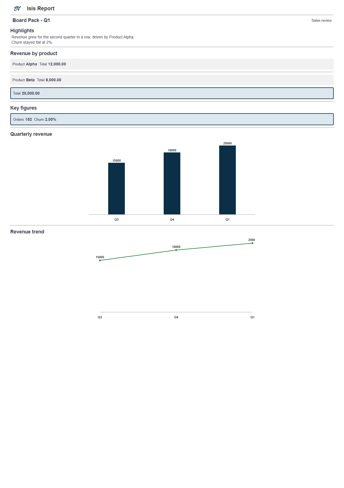

# Gallery

Real outputs, generated from the examples in
[`examples/board_pack.py`](https://github.com/thepaneb/isis-report-lib/blob/main/examples/board_pack.py)
— no mockups or hand-edited screenshots.

## Board pack — composed sections

A board pack with text, a table with totals, KPI cards and two inline SVG
charts, in a single payload.

[](assets/gallery/board-pack.pdf)

[PDF](assets/gallery/board-pack.pdf) ·
[HTML](assets/gallery/board-pack.html) ·
[XLSX](assets/gallery/board-pack.xlsx) ·
[CSV](assets/gallery/board-pack.csv)

The same payload drives every format: PDF and HTML keep the visual layout;
XLSX keeps each table plus a native chart for chart sections; CSV flattens
sections into tables and summary lines. No browser is needed for XLSX/CSV/HTML.

## Account statement — hierarchy and running balance

Nested groups, locale-aware dates and amounts, and a running balance computed
in row order.

[](assets/gallery/statement.pdf)

[PDF](assets/gallery/statement.pdf)

## Reproduce it

```bash
python examples/board_pack.py        # PDFs next to the example
python scripts/gen_gallery.py        # regenerate the artifacts on this page
```

The gallery is committed so the docs build has no browser dependency; the
script is the source of truth for the PNG covers and the download files.
